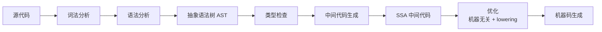

# 前言

希望有一天能够真正有机会和一群志同道合人为梦想努力。

哎呀我去，这玩意怎么这么难，我去了。

至于为什么文章这么长，一方面是有些部分写的过于具体了，比如语法分析那里写了个例子，总的来说还是个总结的文章

有些例题让ai总结了，其余均为手写，虽然大多数与书本一致，但是加了一些自己的理解和提示，方便理解，同时也是当作自己的知识库用，如果有人有更好的例题欢迎提pr或评论。

注意的是，这些知识都很老了。

# 准备工作

## 1.1调试源代码

./src/make.bash脚本会编译 Go 语言的二进制、工具链以及标准库和命令并将源代码和编译好的二进制文件移动到对应的位置上.现在go语言应该是在`$GOROOT/src`下面

Go语言编译过程中需要生成中间代码，中间代码具有 SSA（静态单赋值）的特性

Go编译汇编语法：
```bash
go build -gcflags -S main.go
```
注意go编译的汇编是无法通过GCC汇编器的

Go语言获取汇编指令优化过程：
```bash
GOSSAFUNC=main go build main.go
# runtime
dumped SSA to /usr/local/Cellar/go/1.14.2_1/libexec/src/runtime/ssa.html
# command-line-arguments
dumped SSA to ./ssa.html
```

# 编译原理

## 2.1编译过程

AST（抽象语法树）：

是源代码语法的结构的一种抽象表示，这个抽象语法树会辅助编译器进行语义分析，我们可以用它来确定语法正确的程序是否存在一些类型不匹配的问题。

SSA（静态单赋值）：

静态单赋值（Static Single Assignment、SSA）是中间代码的特性，如果中间代码具有静态单赋值的特性，那么每个变量就只会被赋值一次。SSA 的主要作用是对代码进行优化，所以它是编译器后端的一部分。

指令集：

```bash
uname -m #查看当前电脑硬件信息
```

- 复杂指令集(CISC)
- 精简指令集(RISC)

编译原理：

go的编译器源码在src/cmd/compile，编译器的前端一般承担着词法分析、语法分析、类型检查和中间代码生成几部分工作，而编译器后端主要负责目标代码的生成和优化，也就是将中间代码翻译成目标机器能够运行的二进制机器码。



各阶段对应的包：

| 阶段 | 包 / 关键类型 | 产物 |
| --- | --- | --- |
| 词法分析 | `internal/syntax`（`scanner`） | `token` 流 |
| 语法分析 | `internal/syntax`（`parser`） | `syntax.Node`（语法树） |
| 类型检查 | `internal/types2`（旧版为 `gc`） | 带类型信息的节点 |
| 中间代码生成 | `internal/walk` + `internal/ssa` | `ir.Node` → SSA 值 |
| 后端优化 | `internal/ssa` 的多轮 pass | 机器相关的 SSA |
| 机器码生成 | `internal/ssa` + `internal/objw` | 汇编码 → 目标文件 |


词法分析会返回一个不包含空格、换行等字符的 Token 序列，例如：package, json, import, (, io, ), …，而语法分析会把 Token 序列转换成有意义的结构体，即语法树

每一个 AST 都对应着一个单独的 Go 语言文件，这个抽象语法树中包括当前文件属于的包名、定义的常量、结构体和函数等。

类型检查阶段不止会对节点的类型进行验证，还会展开和改写一些内建的函数，例如 make 关键字在这个阶段会根据子树的结构被替换成 runtime.makeslice 或者 runtime.makechan 等函数。

在类型检查之后，编译器会通过 cmd/compile/internal/gc.compileFunctions 编译整个 Go 语言项目中的全部函数，这些函数会在一个编译队列中等待几个 Goroutine 的消费，并发执行的 Goroutine 会将所有函数对应的抽象语法树转换成中间代码。

## 2.2 词法与语法分析

### 词法分析：

将源代码拆分为Token序列的过程

lex：用于生成词法分析器的工具，lex 生成的代码能够将一个文件中的字符分解成 Token 序列，lex 作为一个代码生成器，使用了类似 C 语言的语法，我们将 lex 理解为正则匹配的生成器，它会使用正则匹配扫描输入的字符流。但是Go有自己的“lex”，而lex自己的办法是.l文件通过lex生成C语言代码，将 C 语言代码通过 gcc 编译成二进制代码之后，就可以使用管道将上面提到的 Go 语言代码作为输入传递到生成的词法分析器中。

Go 语言的词法解析是通过 src/cmd/compile/internal/syntax/scanner.go6 文件中的 cmd/compile/internal/syntax.scanner 结构体实现的，这个结构体会持有当前扫描的数据源文件、启用的模式和当前被扫描到的 Token。

src/cmd/compile/internal/syntax/tokens.go7 文件中定义了 Go 语言中支持的全部 Token 类型。

### 语法分析：

通过文法确定语法结构，文法用来形式化、精确描述某种编程语言的工具，主要包含一系列用于转换字符串的生产规则（Production rule）。文法都由以下的四个部分组成：

终结符是文法中无法再被展开的符号，而非终结符与之相反，还可以通过生产规则进行展开，例如 “id”、“123” 等标识或者字面量。
- N 有限个非终结符的集合；
- Σ 有限个终结符的集合；
- P 有限个生产规则12的集合；
- S 非终结符集合中唯一的开始符号；

如何理解扇面书N，Σ等呢？很简单，可以将其判断为一个规则P，然后逐渐将其中的N替换为对应的含Σ的另一个P然后继续分，比如：

<details class="fold-container">
<summary class="fold-title"><span data-zh="📖 展开完整推导过程（共 13 步）" data-en="📖 Show full derivation (13 steps)">📖 展开完整推导过程（共 13 步）</span></summary>

*第一步：原始C++代码（源码）*
```cpp
int main()
{
    cout << "hello world" << endl;
    return 0;
}
```
> 词法分析之后，得到**终结符Token序列**（就是$\Sigma$里面的符号，无中文）：
```
int  main  (  )  {  cout  <<  "hello world"  <<  endl  ;  return  0  ;  }
```

我们使用文法：
$$
\begin{align*}
G&=(N,\Sigma,P,S)\\
N&=\{Program,\ FuncDef,\ Type,\ Id,\ StmtList,\ Stmt,\ OutputStmt,\ ReturnStmt,\ Constant\}\\
\Sigma&=\{\texttt{int},\texttt{main},\texttt{cout},\texttt{<<},\texttt{"hello world"},\texttt{endl},\texttt{return},\texttt{0},\texttt{(},\texttt{)},\texttt{\{},\texttt{\}},\texttt{;}\}\\
P&=\begin{cases}
Program \rightarrow FuncDef \\
FuncDef \rightarrow Type\ Id\ (\ )\ \{ \ StmtList\ \} \\
Type \rightarrow int \\
Id \rightarrow main \\
StmtList \rightarrow Stmt\ StmtList \\
StmtList \rightarrow \varepsilon \\
Stmt \rightarrow OutputStmt \\
Stmt \rightarrow ReturnStmt \\
OutputStmt \rightarrow cout\ <<\ Constant\ <<\ endl\ ; \\
ReturnStmt \rightarrow return\ Constant\ ; \\
Constant \rightarrow "hello world" \\
Constant \rightarrow 0
\end{cases}\\
S&=Program
\end{align*}
$$

---

*模拟编译器：自顶向下推导（从开始符号$Program$出发，一步步替换）*
> $\Rightarrow$ 代表：使用一条产生式，替换左边非终结符为右边符号串。

1. 起始：$\boldsymbol{Program}$
$$
Program \Rightarrow FuncDef
$$
> 使用规则：$Program \rightarrow FuncDef$

2.
$$
FuncDef \Rightarrow Type\ Id\ (\ )\ \{ \ StmtList\ \}
$$
> 使用规则：$FuncDef \rightarrow Type\ Id\ (\ )\ \{ \ StmtList\ \}$

3. 替换非终结符 $Type$
$$
Type\ Id\ (\ )\ \{ \ StmtList\ \} \Rightarrow \boldsymbol{int}\ Id\ (\ )\ \{ \ StmtList\ \}
$$
> 使用规则：$Type \rightarrow int$

4. 替换非终结符 $Id$
$$
int\ Id\ (\ )\ \{ \ StmtList\ \} \Rightarrow int\ \boldsymbol{main}\ (\ )\ \{ \ StmtList\ \}
$$
> 使用规则：$Id \rightarrow main$

5. 替换非终结符 $StmtList$，选规则 $StmtList\rightarrow Stmt\ StmtList$
$$
int\ main\ (\ )\ \{ \ StmtList\ \} \Rightarrow int\ main\ (\ )\ \{ \ \boldsymbol{Stmt}\ StmtList\ \}
$$
> 使用规则：$StmtList \rightarrow Stmt\ StmtList$

6. 替换第一个 $Stmt$，选 $Stmt\rightarrow OutputStmt$
$$
int\ main\ (\ )\ \{ \ Stmt\ StmtList\ \} \Rightarrow int\ main\ (\ )\ \{ \ \boldsymbol{OutputStmt}\ StmtList\ \}
$$
> 使用规则：$Stmt \rightarrow OutputStmt$

7. 替换 $OutputStmt$
$$
OutputStmt \Rightarrow cout\ <<\ Constant\ <<\ endl\ ;
$$
$$
int\ main\ (\ )\ \{ \ OutputStmt\ StmtList\ \}
\Rightarrow int\ main\ (\ )\ \{ \ cout\ <<\ \boldsymbol{Constant}\ <<\ endl\ ;\ \ StmtList\ \}
$$
> 使用规则：$OutputStmt \rightarrow cout\ <<\ Constant\ <<\ endl\ ;$

8. 替换 $Constant$，选 $Constant\rightarrow "hello world"$
$$
int\ main\ (\ )\ \{ \ cout\ <<\ Constant\ <<\ endl\ ;\ \ StmtList\ \}
\Rightarrow int\ main\ (\ )\ \{ \ cout\ <<\ \boldsymbol{"hello world"}\ <<\ endl\ ;\ \ StmtList\ \}
$$
> 使用规则：$Constant \rightarrow "hello world"$

9. 现在处理剩下的 $StmtList$，继续展开：$StmtList\rightarrow Stmt\ StmtList$
$$
int\ main\ (\ )\ \{ \ cout\ <<\ "hello world"\ <<\ endl\ ;\ \ StmtList\ \}
\Rightarrow int\ main\ (\ )\ \{ \ cout\ <<\ "hello world"\ <<\ endl\ ;\ \ \boldsymbol{Stmt}\ StmtList\ \}
$$
> 使用规则：$StmtList \rightarrow Stmt\ StmtList$

10. 替换第二个 $Stmt$，选 $Stmt\rightarrow ReturnStmt$
$$
int\ main\ (\ )\ \{ \ cout\ <<\ "hello world"\ <<\ endl\ ;\ \ Stmt\ StmtList\ \}
\Rightarrow int\ main\ (\ )\ \{ \ cout\ <<\ "hello world"\ <<\ endl\ ;\ \ \boldsymbol{ReturnStmt}\ StmtList\ \}
$$
> 使用规则：$Stmt \rightarrow ReturnStmt$

11. 替换 $ReturnStmt$
$$
ReturnStmt \Rightarrow return\ Constant\ ;
$$
$$
int\ main\ (\ )\ \{ \ cout\ <<\ "hello world"\ <<\ endl\ ;\ \ ReturnStmt\ StmtList\ \}
\Rightarrow int\ main\ (\ )\ \{ \ cout\ <<\ "hello world"\ <<\ endl\ ;\ \ return\ \boldsymbol{Constant}\ ;\ \ StmtList\ \}
$$
> 使用规则：$ReturnStmt \rightarrow return\ Constant\ ;$

12. 替换这里的 $Constant$，选 $Constant\rightarrow 0$
$$
int\ main\ (\ )\ \{ \ cout\ <<\ "hello world"\ <<\ endl\ ;\ \ return\ Constant\ ;\ \ StmtList\ \}
\Rightarrow int\ main\ (\ )\ \{ \ cout\ <<\ "hello world"\ <<\ endl\ ;\ \ return\ \boldsymbol{0}\ ;\ \ StmtList\ \}
$$
> 使用规则：$Constant \rightarrow 0$

13. 最后剩下的 $StmtList$，使用空串规则 $StmtList\rightarrow \varepsilon$（$\varepsilon$代表删掉，什么都不写）
$$
int\ main\ (\ )\ \{ \ cout\ <<\ "hello world"\ <<\ endl\ ;\ \ return\ 0\ ;\ \ StmtList\ \}
\Rightarrow int\ main\ (\ )\ \{ \ cout\ <<\ "hello world"\ <<\ endl\ ;\ \ return\ 0\ ;\ \ \varepsilon\ \}
$$
> 使用规则：$StmtList \rightarrow \varepsilon$

---

✅ 推导完成
全部非终结符都被替换完毕，只剩下**终结符序列**：
$$
\boldsymbol{int\ main\ (\ )\ \{ \ cout\ <<\ "hello world"\ <<\ endl\ ;\ \ return\ 0\ ;\ \}}
$$
这正好就是我们写的hello world经过词法分析后的Token流。

</details>

---

关键总结：

1. 推导成功 = 语法合法；如果某一步找不到匹配的产生式，就报语法错误。

> 真实编译器是**自底向上归约**（反过来做），上面是自顶向下推导，方便理解。

在这里我们可以从 src/cmd/compile/internal/syntax/parser.go13 文件中摘抄一些 Go 语言文法的生产规则.

自顶向下是先用目标文法来判断当前是否符合，即：你手里只有「目标是 Program」，没有别的信息。于是你猜：Program 大概长成 FuncDef 吧？展开一看，跟输入对上了，继续猜 FuncDef 由 Type Id ( ) { StmtList } 组成……猜错了就退回来换一条规则重猜，这个「退回来」就是回溯。

而自底向上是输入确定，看到栈顶 int 能匹配 Type -> int，就把 int 打包成 Type；看到 return 0 ; 能匹配 ReturnStmt -> return Constant ;而归约成 Program 的那一刻，就等于宣布「语法合法」。

即通过判断Token流是否符合文法来判断是否符合Go语法😢（难难）


Lookahead（向前查看）：

在不同生产规则发生冲突时，当前解析器需要通过预读一些 Token 判断当前应该用什么生产规则对输入流进行展开或者归约。Go语言通过实现即无需额外空间：
```go
if p.tok == tok {   // 先看一眼
    p.next()        // 确认了才消费掉
    return true
  }
```

词法和语法分析一起进行的。

节点：

语法分析器最终会使用不同的结构体来构建抽象语法树中的节点，其中根节点包含了当前文件的包名、所有声明结构的列表和文件的行数。

## 类型检查

强弱类型：大体就是强类型明确定义，弱类型常常隐式转换，Go算强类型语言

静态类型检查：

它能够减少程序在运行时的类型检查，也可以被看作是一种代码优化的方式。

动态类型检查：

动态类型检查是在运行时确定程序类型安全的过程，它需要编程语言在编译时为所有的对象加入类型标签等信息，运行时可以使用这些存储的类型信息来实现动态派发、向下转型、反射以及其他特性6。

执行过程：

Go 语言的编译器不仅使用静态类型检查来保证程序运行的类型安全，还会在编程期间引入类型信息，让工程师能够使用反射来判断参数和变量的类型。

比如切片先检查右侧的类型，然后匹对左侧，而哈希会讲左侧的键加入队列然后在后面才检查，而关键字中make，会在类型检查阶段根据创建的类型讲make替换为特定的函数，然后生成中间代码的过程不会处理OMAKE类型的节点

## 中间代码生成

### 概述

编译过程中，编译器会在将源代码转换到机器码的过程中，先把源代码转换成一种中间的表示形式，即中间代码。Go语言编译器的中间代码具有静态单赋值（SSA）的特性，注意这里的中间代码不是汇编。

### 配置初始化

首先会进行SSA配置初始化。
1. 初始化结构体，缓存指针，优化类型指针的获取效率，一个类型类型指针只有一个，由于类型很大，所以用指针。编译器里每个类型（包括 int、*int、**int）都对应一个 types.Type 对象。指向这些对象的指针叫类型指针。
2. 根据传入的 CPU 架构设置用于生成中间代码和机器码的函数，当前编译器使用的指针、寄存器大小、可用寄存器列表、掩码等编译选项
3. 初始化一些编译器可能用到的 Go 语言运行时的函数

### 遍历与替换

在生成中间代码前还需要替换抽象语法树中节点的一些元素，遍历抽象语法树的函数会将一些关键字和内建函数转换成函数调用。比如： panic、recover 两个内建函数转换成 runtime.gopanic 和 runtime.gorecover 两个真正运行时函数，而关键字 new 也会被转换成调用 runtime.newobject 函数。

### SSA生成

经过 walk 系列函数的处理之后，抽象语法树就不会改变了。通过生成ssa.html文件可以看到其中最左侧就是源代码，中间是源代码生成的抽象语法树，最右侧是生成的第一轮中间代码。其中间代码生成分为二个阶段，一用相关函数将抽象语法树转换为中间代码，二通过多轮迭代更新SSA中间代码。

AST->SSA

在遇到函数调用、方法调用、使用 defer 或者 go 关键字时都会执行cmd/compile/internal/gc.state.callResult 和 cmd/compile/internal/gc.state.call 生成调用函数的 SSA 节点，这些在开发者看来不同的概念在编译器中都会被实现成静态的函数调用，上层的关键字和方法只是语言为我们提供的语法糖.

多轮转换

中间代码需要优化并精简，比如删除打印日志，性能分析的代码

## 机器码生成

机器码的生成过程其实是对 SSA 中间代码的降级（lower）过程，在 SSA 中间代码降级的过程中，编译器将一些值重写成了目标 CPU 架构的特定值

### 指令集架构

作为计算机软件和硬件之间的接口和桥梁，指令集架构定义了支持的数据结构、寄存器、管理主内存的硬件支持，支持的指令集和 IO 模型，建立抽象层

- 复杂指令集：多且复杂，长度不等
- 精简指令集：精简，数量少，使用标准字节长度

### SSA降级

实际上将近 50 轮处理的过程中，lower 以及后面的阶段都属于 SSA 降级这一过程。最后cmd/compile/internal/gc.buildssa 中的 lower 和随后的多个阶段会对 SSA 进行转换、检查和优化，生成机器特定的中间代码，接下来通过 cmd/compile/internal/gc.genssa 将代码输出到 cmd/compile/internal/gc.Progs 对象中，这也是代码进入汇编器前的最后一个步骤。

### 汇编器

汇编器是将汇编语言翻译为机器语言的程序，Go 语言的汇编器是基于 Plan 9 汇编器的输入类型设计的。

## 数据结构

### 数组

计算机为数组分配连续内存保持元素，议案为一维线性数组，也有多维数组。

上限推导

如果为[10]T，其类型在编译进行到类型检查阶段就会被提取出来，随后使用 cmd/compile/internal/types.NewArray创建包含数组大小的 cmd/compile/internal/types.Array 结构体。而[...]T会在 cmd/compile/internal/gc.typecheckcomplit 函数中对该数组的大小进行推导。

语句转换

当数组元素数量小于4个，直接将数组中的元素放置在栈上（不考虑逃逸分析）。而大于4个会将数组中的元素放置到静态区并在运行时取出；

比如：

- 小于4：
```go
var arr [3]int
arr[0] = 1
arr[1] = 2
arr[2] = 3
```
- 大于4
```go
var arr [5]int
statictmp_0[0] = 1
statictmp_0[1] = 2
statictmp_0[2] = 3
statictmp_0[3] = 4
statictmp_0[4] = 5
arr = statictmp_0
```

原因：

栈上直接初始化：元素较少的数组，直接在栈上初始化是高效的。元素很多，编译器需要在栈上生成大量独立的赋值指令（如 MOVQ），会增加编译后代码的体积，并可能因为指令过多而拖慢执行速度。

静态区初始化：将数组放在静态数据区，编译器可以在编译期就计算好所有初始值，并在二进制文件中紧凑地存储为一整块数据。运行时，只需要调用 runtime.memmove 进行一次内存拷贝，就能将整个数组“搬”到栈上。这种“一次拷贝”的方式，远胜于“多次单独赋值”，能显著提升初始化效率。

访问与赋值：

数组为连续内存空间，通过指向开头的指针，元素数量及大小快速访问。Go 语言中可以在编译期间的静态类型检查判断数组越界。数组寻址和赋值都是在编译阶段完成的，没有运行时的参与。

### 切片

切片长度为动态，切片内元素的类型都是在编译期间确定的。可以将切片理解成一片连续的内存空间加上长度与容量的标识。

#### 初始化

三种方法：
```go
arr[0:3] or slice[0:3]
slice := []int{1, 2, 3}
slice := make([]int, 10)
```
其在runtime内部大致是：
```go
type slice struct {
    array unsafe.Pointer // 指向底层数组的第一个元素
    len   int            // 当前长度
    cap   int            // 当前容量
}
```
1. 使用下标：通过下标创建切片最原始也最接近汇编语言的方式，使用下标初始化切片不会拷贝原数组或者原切片中的数据，它只会创建一个指向原数组的切片结构体，所以修改新切片的数据也会修改原切片

```go
func newSlice() []int {
	arr := [3]int{1, 2, 3}
	slice := arr[1:2]//这里array指向的底层数组则是arr[1]
	return slice
}
```

2. 字面量 使用[]int{1,2,3}创建时（实际上当元素大于一定值后才会选择用静态模板），编译期间会展开为：
```go
var vstat [3]int
vstat[0] = 1
vstat[1] = 2
vstat[2] = 3
var vauto *[3]int = new([3]int)
*vauto = vstat //将静态存储区的数组 vstat 赋值给 vauto 指针所在的地址
slice := vauto[:]
```
为什么要这么麻烦呢，一vstat是会标记位readonly（只读），二new是切片需要可追加，需要逃逸到堆上，三[:]是将指针，len，cap打包成header作为切片

3. 关键字（make）：当切片发生逃逸或者非常大时，运行时需要在堆上初始化切片。如果当前的切片不会发生逃逸并且切片非常小的时候，make([]int, 3, 4) 会被直接转换成如下所示的代码：
```go
var arr [4]int
n := arr[:3]
```
#### 访问元素

使用 len 和 cap 获取长度或者容量是切片最常见的操作，访问切片中的字段可能会触发 “decompose builtin” 阶段的优化，len(slice) 或者 cap(slice) 在一些情况下会直接替换成切片的长度或者容量，不需要在运行时获取。访问切片中元素使用的 OINDEX 操作也会在中间代码生成期间转换成对地址的直接访问。

#### 追加和扩容

如果 append 返回的新切片不需要赋值回原有的变量，就会进入如下的处理流程：
```go
// append(slice, 1, 2, 3)
ptr, len, cap := slice
newlen := len + 3
if newlen > cap {
    ptr, len, cap = growslice(slice, newlen)
    newlen = len + 3
}
*(ptr+len) = 1
*(ptr+len+1) = 2
*(ptr+len+2) = 3
return makeslice(ptr, newlen, cap)
```
大概就是：先获取slice的数组指针，len和cap，将len增加，如果大于cap则获取新底层数组，之后通过地址赋值，最后创建新切片，所以如果没有超过cap会用同一个底层数组的

如果使用 slice = append(slice, 1, 2, 3) 语句，那么 append 后的切片会覆盖原切片，这时 cmd/compile/internal/gc.state.append 方法会使用另一种方式展开关键字：
```go
// slice = append(slice, 1, 2, 3)
a := &slice
ptr, len, cap := slice
newlen := len + 3
if uint(newlen) > uint(cap) {
   newptr, len, newcap = growslice(slice, newlen)
   vardef(a)
   *a.cap = newcap
   *a.ptr = newptr
}
newlen = len + 3
*a.len = newlen
*(ptr+len) = 1
*(ptr+len+1) = 2
*(ptr+len+2) = 3
```
如果我们选择覆盖原有的变量，就不需要担心切片发生拷贝影响性能，因为 Go 语言编译器已经对这种常见的情况做出了优化。实际上只要扩容了就是新的底层数组。

为什么 *a.cap 写在 *a.ptr 前面？
因为写 ptr 要调写屏障，cap 这期间还得占着寄存器，先落盘能少一次寄存器溢出。

有些其实难想明白，虽然说传副本仍然是同一个底层数组，但是仅仅读操作并不会出现危害吧，然而我发现ai写代码时会尽可能避开。

一个有趣的：
```go
var a []int
fmt.Println(a == nil) // true

b := []int{}
fmt.Println(b == nil) // false
//nil 切片可以直接 append，Go 会自动分配底层数组。
s := []int{1, 2, 3, 4, 5}
a := s[1:3]     // len=2, cap=4
b := s[1:3:3]   // len=2, cap=2
//三索引切片可以限制容量
```

对了，即使是:=也是同一个底层数组：
```go
arr := [5]int{1, 2, 3, 4, 5}
s := arr[1:3] // [2,3]
```
s 的底层数组仍然是 arr：
- len(s) = 3 - 1 = 2
- cap(s) = len(arr) - 1 = 4
- 修改 s[0] 会影响 arr[1]

问题：大数组小切片导致内存泄漏
```go
func getSub() []int {
    big := make([]int, 1_000_000)
    return big[:10]
}//返回的切片只用了 10 个元素，但整个底层数组仍被引用，无法被 GC 回收。
```

扩容具体实现简要讲下，函数：`func growslice(et *_type, old slice, cap int) slice`；cap是期望扩容的容量，当cap > old的cap的两倍，则新容器的容量直接等于cap否则判断：当old长度小于1024则新容量为old的两倍，大于则循环增加25%直至大于期望容量。

有个地方注意下：其a[low:high:max],必须0≤low≤high≤max≤cap(a)。

#### nil slice和empty slice

```go
var a []int        // nil slice
b := []int{}       // 非 nil 空切片
c := make([]int, 0) // 非 nil 空切片
```

#### 拷贝切片

分为运行时与非运行时，但是二者都会将整块内存的内容拷贝到目标的内存区域中。所有需要注意性能

#### 考题

<details>
<summary>切片考题</summary>
1. 切片底层结构？  
答：指向底层数组的指针 + len + cap。64 位下 slice header 通常 24 字节。

2. len 和 cap 区别？  
答：len 是当前可访问长度；cap 是从切片起始位置到底层数组末尾的容量。

3. nil 切片和空切片区别？  
答：nil 切片 array=nil，JSON 为 `null`；空切片非 nil，JSON 为 `[]`。两者都能 append、len、range。

4. 数组和切片区别？  
答：数组定长、值类型，赋值复制整个数组；切片变长，赋值只复制 slice header，底层数组共享。

5. `make([]int,2,5)` 的 len/cap？  
答：len=2，cap=5。可直接访问前 2 个元素，但可通过 `s[:5]` 扩展到 5 个。

6. `s[low:high]` 的 len/cap？  
答：len=`high-low`，cap=`cap(s)-low`。新切片仍共享底层数组。

7. 三索引切片 `s[l:h:m]` 作用？  
答：限制新切片 cap=`m-l`，防止 append 覆盖原切片后面的元素。

8. append 底层行为？  
答：容量够就写底层数组，返回 len 增加的新 header；容量不够就分配新数组、复制、追加。

9. 为什么必须 `s = append(s, x)`？  
答：append 返回新 slice header，len/cap/底层数组都可能变，不接收返回值原变量不会更新。

10. 切片扩容策略？  
答：小容量通常翻倍，大容量约 1.25 倍增长；实际 cap 受版本和内存对齐影响，不保证精确值。

11. `a:=[]int{1,2,3,4}; b:=a[:2]; b=append(b,99)` 输出？  
答：`a=[1 2 99 4]`，`b=[1 2 99]`。b 的 cap=4，append 容量够，直接覆盖 `a[2]`。

12. 改成 `b:=a[:2:2]; b=append(b,99)` 呢？  
答：`a=[1 2 3 4]`，`b=[1 2 99]`。三索引把 b 的 cap 限制为 2，append 触发扩容，不再覆盖 a。

13. 切片传参是值传递还是引用传递？  
答：值传递，复制 slice header，底层数组共享。函数内改元素外部可见，改 header 外部不可见。

14. `func f(s []int){s=append(s,4)}; s:=make([]int,3,5); f(s)` 后 s？  
答：s 仍是 `[0 0 0]`，len=3，cap=5。函数内 append 写到了底层数组，但外部 len 没变。

15. copy 规则？  
答：复制 `min(len(dst), len(src))` 个元素，不扩容，不改变 dst 的 len/cap。

16. `s:=make([]int,0,5); copy(s, []int{1,2,3})` 会复制吗？  
答：不会，复制 0 个。copy 看 `len(dst)`，此时 len=0，cap 再大也没用。

17. 如何完整复制切片？是深拷贝吗？  
答：`make+copy`、`append([]T(nil), s...)`、`slices.Clone`。都是浅拷贝，元素若为指针/切片/map 仍共享底层对象。

18. 大数组小切片有什么问题？  
答：`small := big[:1]` 仍引用整个 big 底层数组，导致大数组无法 GC。可用 `append([]T(nil), big[:1]...)` 切断。

19. 切片删除元素怎么写？  
答：`s = append(s[:i], s[i+1:]...)`。会修改底层数组；元素含指针时，最好把末尾置零防内存泄漏。

20. 切片并发安全吗？能做 map key 吗？  
答：并发不安全；切片不可比较，不能做 map key。

21. range 切片时 append 会影响遍历次数吗？  
答：不会。range 开始时复制 slice header，遍历次数由当时的 len 决定。

22. 切片越界规则？  
答：`s[low:high]` 要求 `0 <= low <= high <= cap(s)`，不是 `len(s)`，所以可以 `s[:cap(s)]` 扩展 len 到 cap。
</details>

### 哈希表

读写O(1)。由于输入终会大于输出，所以需要解决冲突，方法：
- 开放寻址法：发生冲突则写入下个索引不为空的位置，对性能影响最大的是装载因子（数组中元素的数量与数组大小的比值）
- 拉链法：简要就是数组加上链表（装载因子:=元素数量÷桶数量）

反正大体就是通过hash函数将一串任意数据转换为一串数字。比如：index := hash(aim) % array.len

go中的hmap，哈希表中桶的数量都 2 的倍数（通常？），存在一个叫哈希种子的东西hash0），用于引入随机性。oldbuckets是哈希在扩容时用于保存之前 buckets 的字段，它的大小是当前 buckets 的一半（现在不理解为什么是一半）。还有就是有个东西叫溢出桶用于减少扩容频率。


```text
桶数组 buckets：有 2^B 个桶
每个桶 bmap：
    tophash[8]   // 8个槽分别对应的高8位
    keys[8]      // 8个key
    values[8]    // 8个value
    overflow *bmap
```

还有个优化是其桶有个tophash字段，存储键的哈希高8位，以减少访问键值对的次数。

bmap:
```go
type bmap struct {
    topbits  [8]uint8
    keys     [8]keytype
    values   [8]valuetype
    pad      uintptr
    overflow uintptr
}
```

#### 初始化

同样根据大小分，当小于25个时，会一次加入好哈希表中，大于时会先创建数组分别存储键和值，然后循环加入哈希。当桶得数量较少时，会省略溢出桶得创建。

#### 读写

访问可以通过下标和遍历，如果是两个参数返回一个bool用于判断键值对是否存在。hmap是桶而bmap是槽，高8位存到这个key对应的tophash，第B位决定选择哪个bucket（桶），有个误区，就是这里低B位不是除了高8位的其余位数，其实中间还有很多位，高8位用来快速跳过不匹配的。遍历会将正常桶和溢出桶都遍历，通过一个桶中的overflow指向的是下一个溢出桶

#### 扩容

触发条件：负载因子 > 6.5

1. 翻倍扩容：新桶数量 = 旧桶数量 x ，旧桶元素会分裂到两个新桶中
2. 等量扩容： 当B < 15时，如果 noverflow >= 2^B 或 B >= 15时，如果noverflow >= 2^15 就会触发，其B不变，新桶数量与旧桶一致。

先讲解下等量扩容，可能会认为桶的数量没有增加，就像饭满了，即使有新的碗装也会慢，其实有种情况是：
```text
旧桶 i：
  主桶：8 个槽，实际有效 5 个，3 个空
  溢出桶1：8 个槽，实际有效 2 个，6 个空
  溢出桶2：8 个槽，实际有效 1 个，7 个空
  溢出桶3：8 个槽，实际有效 0 个，8 个空
```
也就是说，删除map元素是，go不会回收，而是将槽标记成 emptyOne 或 emptyRest。这样会出现很多空位，而等量扩容则是创建新的空桶，然后将8个桶装满才装溢出桶，相当于填满了空位。然而因为是渐进式扩容，则会导致如果在扩容中，删除了元素，仍然会在新桶中造成空位。

而翻倍扩容，会增加一位B，按照增加的位是1或0分配不同的两个桶，旧桶i如果新增0去新桶i，1去新桶i+oldLen。oldLen = 2_oldB。


渐进式扩容：会创建新的桶和溢出桶，保留原有的桶并设置到oldbuckets上，之后每次对 map 进行写、删等操作时，会触发 growWork，迁移至少两个桶。通过哈希计数器nevacuate在所有的旧桶都被分流后清空哈希的 oldbuckets 和 oldoverflow。在获取键值时会先去oldbuckets。


#### 考题
<details>
<summary>常见考题</summary>
1. Go map 底层结构？
经典实现：hmap + bmap。hmap 有 count、flags、B、hash0、buckets、oldbuckets、nevacuate 等；bmap 是桶，默认存 8 个 KV，含 tophash[8]、key 数组、value 数组、overflow 指针。

2. 哈希冲突怎么解决？
链地址法变种：一个桶 8 个槽，满了挂 overflow 桶，形成溢出桶链表。

3. key 如何定位到桶？
hash(key) 后，低 B 位选桶，因为桶数 2^B，可用位运算代替取模；高 8 位存 tophash，用于桶内快速过滤。

4. tophash 有什么用？
存 hash 高 8 位，先比 tophash 再比完整 key，减少比较开销。还有特殊值：emptyOne、emptyRest、evacuatedX/Y 等。

5. 负载因子是多少？为什么？
经典实现是 6.5。每个桶 8 槽，平均超过 6.5 后溢出桶概率明显升高，查找退化，所以触发翻倍扩容。

6. 扩容触发条件？
- 负载因子 > 6.5：翻倍扩容，B+1，桶数 ×2。
- 溢出桶过多：等量扩容，B 不变，重新整理桶，减少溢出链。
条件大致：B<15 时 noverflow >= 2^B，否则 >= 2^15。

7. 扩容过程？
渐进式扩容。创建新桶，oldbuckets 指向旧桶，nevacuate 记录迁移进度。每次写/删触发迁移，至少迁移当前桶和 nevacuate 桶。读时若旧桶未迁移，会去旧桶读。迁移完释放旧桶。

8. 翻倍扩容和等量扩容区别？
翻倍：解决元素太多；等量：解决溢出桶太多但元素不多，让数据更紧凑。

9. 为什么 map 遍历顺序随机？
迭代器随机选起始 bucket 和 cell，且扩容迁移影响顺序。不要依赖遍历顺序。

10. 遍历中能删除吗？能新增吗？
删除安全，但可能删到未遍历的；新增不保证被遍历到。并发读写一定不安全。

11. map 并发安全吗？
不安全。并发读写可能 fatal error: concurrent map read and map write，并发写可能 concurrent map writes。运行时用 flags 检测，但不是 100% 必现。

12. nil map 和空 map 区别？
nil map 可读、len=0、可 range、delete 不 panic，但不能写，写会 panic。空 map 可读写。

13. map key 必须可比较吗？
是。slice、map、func 不能做 key；结构体含不可比较字段也不行。interface 可做 key，但动态类型必须可比较。

14. 为什么 map 元素不可取地址？
因为扩容/迁移会导致元素位置变化，&m[k] 会失效。所以不能直接改结构体字段：
tmp := m[k]; tmp.Field = x; m[k] = tmp。

15.删除元素会释放内存吗？
通常不会立即释放桶，只标记 emptyOne/emptyRest。大量删除后内存可能仍高，可重建 map。旧桶在扩容迁移后才释放。

16. map 会自动缩容吗？
不会。经典 map 只增不减，等量扩容也不减少 B。

17. hash0 作用？
随机种子，参与哈希，防止哈希碰撞攻击，使不同 map 实例哈希不同。

18. make(map, hint) 有什么用？
根据 hint 估算 B，预分配桶，减少扩容。

19. map 的 len 和 cap？
len 是元素个数；cap 不适用。

20. NaN 作为 key 的坑？
可以插入，但 NaN != NaN，查找和删除可能无法命中。range 能遍历到。

二、sync.Map 高频题
1. sync.Map 原理？
空间换时间，内部有 read 只读 map 和 dirty 可写 map。读多写少、key 稳定时性能好。

2. sync.Map 和 map+锁怎么选？
读多写少、key 基本不变：sync.Map。写多、需要 len、复杂范围操作：RWMutex + map 或分片锁。

3. sync.Map 适合写多吗？
不适合。写多会频繁操作 dirty，miss 多了还要提升 dirty，可能不如加锁 map。

4. sync.Map Range 是一致快照吗？
不是，不保证一致快照。

三、使用陷阱常考
- map 并发读写会 fatal，不是 panic 可 recover。
- map 元素不可寻址。
- nil map 可读不可写。
- map 遍历顺序随机。
- map 删除不缩容。
- map key 必须可比较。
- interface{} 做 key，动态类型不可比较会 panic。
- 大量增删的长期 map 建议定期重建。
四、算法题常考 Hash 题
- 两数之和：map 存 值 -> 下标。
- 字母异位词分组：排序字符串或计数数组做 key。
- 最长连续序列：set，找连续段起点。
- 无重复字符最长子串：滑动窗口 + map 记录位置。
- 和为 K 的子数组：前缀和 + map 计数。
- 四数相加 II：分组 map 计数。
- 三数之和：排序 + 双指针，去重。
- 有效的字母异位词：计数数组。
- 同构字符串 / 单词规律：双 map 映射。
- 快乐数：set 判环。
- 重复 DNA 序列：map 计数。
- 两个数组交集：set。
- 字符串第一个唯一字符：计数。
- LRU 缓存：map + 双向链表。
- LFU 缓存：map + 频率链表。
- 设计哈希集合/映射：数组 + 链表。
- 常数时间插入删除随机：数组 + map。
- 随机黑名单：map 映射。
- TinyURL：map 编解码。
- 数组中的第 K 个最大元素：哈希/堆/快排，但哈希不是最优。

五、背诵版一句话
Go map 经典结构是 hmap + bmap，桶内 8 槽，冲突挂溢出桶；负载因子 6.5 触发翻倍扩容，溢出桶过多触发等量扩容，扩容是渐进式；map 非并发安全，遍历随机，元素不可寻址，key 必须可比较，删除不缩容；读多写少可用 sync.Map。Go 1.24 后底层改为 Swiss Table。
</details>

### 字符串

#### 结构

首先是只读的，所以需要避免改动带来的性能消耗。有Data和Len字段。以通过在 string 和 []byte 类型之间反复转换实现修改。

#### 拼接

使用+拼，如果字符串数量<=5,则会调用concatstring{2，3，4，5}等函数，超过了则使用runtime.concatstrings传入数组切片。

#### 类型转换

开销大，注意runtime.slicebytetostring等函数，因为字节数组转换为字符串需要使用该函数，根据传入的缓冲区大小决定是否需要为新字符串分配一片内存空间，然后通过 runtime.memmove 将原 []byte 中的字节全部复制到新的内存空间中。想要将字符串转换成 []byte 类型时，需要使用 runtime.stringtoslicebyte 函数（如果有缓冲区则将其内容存储[]byte，否则拷贝字符串内容到[]byte.）

#### 考题

<details>
<summary>字符串考题</summary>
1. string 底层结构？  
答：一个指向字节数组的指针 + 长度，64 位下 16 字节。本质是只读的字节序列，没有 cap。

2. 为什么 string 设计成不可变？  
答：可以多处安全共享而不用拷贝；可安全做 map key、比较和常量折叠；天然并发安全。

3. string 和 []byte 区别？  
答：string 只读、可比较、可做 map key；[]byte 可写、不可比较。两者互转都会拷贝。

4. `string(b)` 和 `[]byte(s)` 的开销？  
答：都是 O(n) 拷贝，分别调用 runtime.slicebytetostring 和 runtime.stringtoslicebyte，根据传入缓冲区大小决定是否新分配内存再用 memmove 复制。

5. 有零拷贝转换吗？  
答：标准库没有。可以用 unsafe 重解释指针（unsafe.String / unsafe.SliceData）实现零拷贝，但结果与原数据共享内存，必须保证只读，否则破坏 string 不可变的前提。

6. `+` 拼接底层怎么走？  
答：个数 ≤5 时编译器调用 concatstring2~5 在栈上拼；更多时调用 runtime.concatstrings 传入切片，先遍历求总长，再一次性分配并拷贝。

7. 为什么循环里 `s += x` 很慢？  
答：每轮都重新分配并拷贝整个字符串，复杂度 O(n²)。应该改用 strings.Builder。

8. strings.Builder 为什么快？  
答：内部是 []byte，WriteString 用 copy 追加，只在扩容时重新分配；String() 用 unsafe 把内部 []byte 零拷贝转成 string。它不能被复制，复制会 panic。

9. `len(s)` 是字符数吗？  
答：不是，是字节数。一个中文 UTF-8 字符占 3 字节，emoji 可能 4 字节。字符数要用 utf8.RuneCountInString。

10. `s[0]` 和 `range s` 有什么区别？  
答：`s[i]` 取第 i 个字节（byte）；range 按 UTF-8 解码，每次给出 rune 和该字符起始的字节下标。

11. 子串 `s[i:j]` 会拷贝吗？  
答：不会，新 string 与原 string 共享底层字节数组。截取大字符串的一小段会让整块内存无法被 GC，可用 strings.Clone（Go 1.18+）切断。

12. string 能比较、能做 map key 吗？  
答：能。`==` 按字节比较，结果稳定；string 可比较所以可做 map key，[]byte 不行。

13. string 是值类型还是引用类型？  
答：值类型。赋值和传参复制的是 header（指针 + 长度），底层字节数组共享且只读。

14. 修改字符串的正确姿势？  
答：转成 []byte 或 []rune，改完再转回 string。[]byte 按下标改字节，[]rune 按下标改字符，两者下标含义不同。

15. 大量拼接选谁？  
答：strings.Builder（只追加、无格式）> bytes.Buffer（可读可写）> fmt.Sprintf（走反射和接口，慢）> 循环 `+`（最慢）。元素个数已知时用 strings.Join。

16. 什么时候 `[]byte` 转 string 不分配？  
答：只有编译器能证明转换结果不逃逸、且属于临时用途时（如 `m[string(b)]` 查找、字符串比较、拼接中间量）才免分配。这是编译器优化，不是语言保证。
</details>

> ⚠️ 一句话背诵：string 是只读的字节序列（指针 + 长度），与 []byte 互转必然拷贝；`+` 少量拼走 concatstringN、大量走 concatstrings；高频拼接用 strings.Builder；子串不拷贝会拖住原内存，需要时用 strings.Clone 切断。

## 语言基础

### 函数调用

#### C

先看看C语言，在函数my_function调用前，main函数将其两个参数存储到edi和esi寄存器，调用时会将edi和esi的数据存储到eax和edx寄存器中然后计算其和，调用后所以寄存器eax传递返回值，main函数将其返回值存储到栈上的i变量中。

当入参过多时（比如增加到八个时），前6个参数所以edi，esi，edx，ecx，r8d和r9d六个寄存器传递，且会先为参数传递申请栈空间，而最后二个参数会使用栈传递参数。从右到左的顺序，然后通过call my_function调用函数my_function。

rbp存储函数调用栈的基址指针，rsp存储main函数调用栈结束的位置，其两个寄存器共同表示了函数的栈空间。

my_function会将寄存器的全部数据先转移到栈上，然后利用eax寄存器返回数据。由于只使用一个寄存器存储返回值，使用C语言无法同时返回多个值。

#### Go

```go
package main

func myFunction(a, b int) (int, int) {
	return a + b, a - b
}

func main() {
	myFunction(66, 77)
}
```

其参数压入栈的顺序与C一致从右到左。栈是向下增长的，所以可以看到66在“top of stack”

先了解下经典进程的虚拟内存布局：由低地址到高地址为代码段-数据段-堆（向上【高地址】增长）-空闲地址-栈（向下【低地址】增长），关键区分：栈（stack）属于线程私有，自动分配释放，大小较小，存储函数调用，局部变量，BP/SP，返回地址。而堆（heap）进程共享，大小很大，由操作系统堆管理器维护。（这样可以知道他这个图特么是倒过来的，实际应该理解为栈顶向上面，即低地址）

然后了解下go老版本具体会如何做。

调用函数外部：


可以看出会提前为其分哦40字节栈空间，通过32(SP)偏移将基址指针存储到栈上，然后按一字节8bit偏移将66，77压入栈，最后将基址指针压回BP。讲下BP的作用：代表当前函数栈帧（stack frame）的基准起点，而SP（stack pointer）则是栈顶指针，一直变动。函数调用结束后回复BP，然后堆SP+40恢复栈帧。注意这里有个LEAQ 32(SP),BP的意思是将sp偏移32位后的地址赋值给BP，这样该函数的栈存放上一个调用该函数的栈帧，而现在的栈帧BP则存储当前函数的栈帧.

调用函数内部：


首先会为返回值初始化，会将int类型初始化默认值0，之后通过AX寄存器进行计算，然后存储到返回值对应的地址空间中。

Go和C对比：
- C：
  - 可以极大减少函数调用的额外开销但是也增加了实现的复杂度
    - CPU访问栈开销位寄存器几十倍
    - 需要单独除了函数参数过多的情况
- Go：
  - 降低实现复杂度且支持多返回值，但是牺牲了函数调用的性能：
    - 无需考虑查过寄存器数量的参数如何传递
    - 无需考虑不同架构上寄存器的差异
    - 函数入参出参由栈直接分配

#### 参数传递

首先肯定是传值和传引用的区别，就不赘述了。Go选择了传值，无论传递什么都会对其进行拷贝。

```go
type MyStruct struct {
	i int
	j int
}

func myFunction(ms *MyStruct) {
	ptr := unsafe.Pointer(ms)
	for i := 0; i < 2; i++ {
		c := (*int)(unsafe.Pointer((uintptr(ptr) + uintptr(8*i))))
		*c += i + 1
		fmt.Printf("[%p] %d\n", c, *c)
	}
}

func main() {
	a := &MyStruct{i: 40, j: 50}
	myFunction(a)
	fmt.Printf("[%p] %v\n", a, a)
}

$ go run main.go
[0xc000018180] 41
[0xc000018188] 52
[0xc000018180] &{41 52}
```

可以了解先go的unsafe包，讲解下unsafe.pointer，他可以和任意指针类型转换，但是不可以进行计算，将其转换为uintptr即可进行地址计算。由于int在64为系统占8字节，所以按8进行偏移。用unsafe包是危险的。

可能会疑惑汇编中MOVQ "".ms+8(SP), AX这些是值将什么移动到什么，实际上这个根据电脑的系统决定，比如64位上意思就是：：从内存地址 SP + 8 处，读取 8 个字节的数据，并存入到 CPU 寄存器 AX 中。

### 接口

#### 概述

接口本质就是一个新的中间层，实现定义与具体实现分离，用于解耦。比如sql就是，无需关注内部是mysql，postgresql还是sqlite，只需关注sql本身。

像java和C#的接口不仅可以定义方法签名还可以定义变量，变量可以直接在实现接口的类中使用。而java需要implements关键字显示指定实现了什么接口，而go不需要，很显然的是，go一个实现可能对应不同接口，也就是鸭子类型，会叫的就是鸭子。只需要函数名称，入参与出参一致即可，这就是隐式接口。

接口本身也是Go语言中的一种类型，go有带方法的和不带方法的interface{}

Go语言使用 runtime.iface 表示第一种接口，使用 runtime.eface 表示第二种不包含任何方法的接口 interface{}。而interface[]并不像C语言的void *表示任意类型，而是单独的类型。所以在函数传参时实际上会将其转换为interface{}类型。

指针和接口这方面可以看到两种不同的方式：


```go
type Duck interface{
    Walk()
}
type Cat struct{}

func(c *Cat) Walk(){

}
//and
func(c Cat) Walk(){

}
```

两种实现方式不可以同时存在，具体区别就是注入实现的时候是所以结构体还是结构体指针：

```go
type Cat struct {}
type Duck interface {
    Quack()
}

func (c  Cat) Quack {}  // 使用结构体实现接口
func (c *Cat) Quack {}  // 使用结构体指针实现接口

var d Duck = Cat{}      // 使用结构体初始化变量
var d Duck = &Cat{}     // 使用结构体指针初始化变量
```
||结构体实现接口|结构体指针实现接口|
|:--:|:--:|:--:|
|结构体初始化变量|通过|不通过|
|结构体指针初始化变量|通过|通过|

原理：当使用结构体实现，指针初始化时，调用时相当于C的->，可以隐式获取对应方法。总而言之，因为go永远是值拷贝，如果是结构体实现则拷贝结构体，如果是指针实现则拷贝指针。当直接实现时其*Cat 的方法集包含 Quack(),Cat 的方法集不包含 Quack()，而结构体实现时二者都有。

```go
type Cat struct {
    Name string
}

func (c Cat) Quack() {
    c.Name = "changed"
}
```

|调用|编译器实际做的|拷贝什么|方法里改 c.Name 会影响外面吗|
|:--:|:--:|:--:|:--:|
|c:=Cat{};c.Quack()|c.Quack()|拷贝整个 Cat 值|不会|
|c:=&Cat{};c.Quack()|(*c).Quack()|先解引用得到 Cat，再拷贝整个 Cat 值|不会|

```go
func (c *Cat) Quack() {
    c.Name = "changed"
}
```

|调用|编译器实际做的|拷贝什么|方法里改 c.Name 会影响外面吗|
|:--:|:--:|:--:|:--:|
|c := Cat{}; c.Quack()|(&c).Quack()|拷贝 &c 这个指针值|会，改的是原变量 c|
|c := &Cat{}; c.Quack()|c.Quack()|拷贝指针 c 的值|会，改的是指针指向的同一个 Cat|

ok，看到这里我邮电头皮发麻了，不过多看几遍你就懂了，反正主要变的就是接口用什么赋值，实现用指针还是值。只是赋值给接口时，不可以当实现用接口而赋值用值，这个目的是为了避免：
```go
func (t *T) SetName(s string) {
    t.Name = s
}//这个方法的意思是：“改我指向的那个 T”
var i I = T{}   // 假设允许
i.SetName("x")  // 改的是谁？
```
这里i是T的副本，而T中表明了可能更改T的值，那么i是无法更改原本的值的，为了避免歧义，go选址不允许。

#### 数据结构

Go语言按照是否包含一组方法将接口分为了两类：
- runtime.iface表示包含方法
- runtime.eface表示不包含方法

```go
type eface struct { // 16 字节
	_type *_type
	data  unsafe.Pointer
}
type iface struct { // 16 字节
	tab  *itab
	data unsafe.Pointer
}
```

首先可以看到无方法的eface在改为了_type，这是Go语言类型运行时的表示：
```go
type _type struct {
	size       uintptr //存储了类型占用的内存空间，为内存空间的分配提供信息
	ptrdata    uintptr
	hash       uint32 //快速确定类型是否相等
	tflag      tflag
	align      uint8
	fieldAlign uint8
	kind       uint8
	equal      func(unsafe.Pointer, unsafe.Pointer) bool //判断当前类型的多个对象是否相等
	gcdata     *byte
	str        nameOff
	ptrToThis  typeOff
}
```
然后看有方法的itab:
```go
type itab struct { // 32 字节
	inter *interfacetype
	_type *_type
	hash  uint32 //hash 是对 _type.hash 的拷贝，用于快速判断是否与具体类型一致
	_     [4]byte
	fun   [1]uintptr //动态大小的数组，它是一个用于动态派发的虚函数表，存储函数指针。
}
```
其中inter个_type用于表示类型。

#### 类型转换

依旧看Duck的接口，上面有。很显然可以知道会有的过程：
- 初始化Cat
- 赋值转换
- 调用接口方法

1. cat初始化：
   ```go
    LEAQ	type."".Cat(SB), AX                ;; AX = &type."".Cat
    MOVQ	AX, (SP)                           ;; SP = &type."".Cat
    CALL	runtime.newobject(SB)              ;; SP + 8 = &Cat{}
    MOVQ	8(SP), DI                          ;; DI = &Cat{}
    MOVQ	$6, 8(DI)                          ;; StringHeader(DI.Name).Len = 6
    LEAQ	go.string."draven"(SB), AX         ;; AX = &"draven"
    MOVQ	AX, (DI)                           ;; StringHeader(DI.Name).Data = &"draven"
   
   ```
直接用书：
1. 获取 Cat 结构体类型指针并将其作为参数放到栈上；
2. 通过 CALL 指定调用 runtime.newobject 函数，这个函数会以 Cat 结构体类型指针作为入参，分配一片新的内存空间并将指向这片内存空间的指针返回到 SP+8 上；
3. SP+8 现在存储了一个指向 Cat 结构体的指针，我们将栈上的指针拷贝到寄存器 DI 上方便操作；
4. 由于 Cat 中只包含一个字符串类型的 Name 变量，所以在这里会分别将字符串地址 &"draven" 和字符串长度 6 设置到结构体上，最后三行汇编指令等价于 cat.Name = "draven"；

转换过程：

```go
LEAQ	go.itab.*"".Cat,"".Duck(SB), AX    ;; AX = *itab(go.itab.*"".Cat,"".Duck)
MOVQ	DI, (SP)                           ;; SP = AX
```

我们知道了iface结构体一个表示类型一个指向数据，，这段代码将编译期间生成的itab结构体复制到SP上:


看到 SP ~ SP+16 共同组成了 runtime.iface 结构体，其中*Cat相当于指向数据的指针。实际调用：
```go
CALL    "".(*Cat).Quack(SB)                ;; SP.Quack()
```
这里Go编译器在编译期间将动态派发的发给发调用改为目标方法的直接调用以减少性能开销，如果禁用编译器优化就可以看到动态派发过程。

前面是指针赋值，如果通过值赋值给接口将会在栈上初始化Cat，而原本用地址在栈上只有个指针指向堆中的Cat。

其类型转换回调用runtime.convT2I函数，回根据类型申请内存空间并将elem指针的内容拷贝到目标内存中：

```go
func convT2I(tab *itab, elem unsafe.Pointer) (i iface) {
	t := tab._type
	x := mallocgc(t.size, t, true)
	typedmemmove(t, x, elem)
	i.tab = tab
	i.data = x
	return
}
```
先看图：

可以看到是先弄个指针指向Cat，然后将类型赋值到栈顶，然后调用convT2I函数，这是函数返回前的栈示意图（其中的入参还没有消除），理解其unsafe.pointer是：
```go
LEAQ	""..autotmp_1+32(SP), AX           ;; AX = &(SP+32) = &Cat{Name: "draven"}
MOVQ	AX, 8(SP)                          ;; SP + 8 = AX
```
先用LEAQ计算出Cat的地址放AX中，然后将其存放在8(SP)，于是出现了unsafe.pointer,注意这里的SP不是这个图，这个图是函数调用前更改了SP的，现在SP应该是蓝色的itab和黄色的*Cat之间。

调用：
```go
MOVQ	16(SP), AX ;; AX = &(go.itab."".Cat,"".Duck)
MOVQ	24(SP), CX ;; CX = &Cat{Name: "draven"}
MOVQ	24(AX), AX ;; AX = AX.fun[0] = Cat.Quack
MOVQ	CX, (SP)   ;; SP = CX
CALL	AX         ;; CX.Quack()
```
重点看MOVQ 24(AX), AX，这里不是说在16(SP)在偏移24，而是说将16(SP)的itab结构体在取Cat.Quack方法指针作为 CALL 指令调用时的参数。即接口变量的第 24 字节是 itab.fun 数组开始的位置。

#### 类型断言

非空接口，将Duck转换为Cat结构体的过程：
```go
func main() {
	var c Duck = &Cat{Name: "draven"}
	switch c.(type) {
	case *Cat:
		cat := c.(*Cat)
		cat.Quack()
	}
}
```
变量初始化：
```go
00000 TEXT	"".main(SB), ABIInternal, $32-0
...
00029 XORPS	X0, X0
00032 MOVUPS	X0, ""..autotmp_4+8(SP)
00037 LEAQ	go.string."draven"(SB), AX
00044 MOVQ	AX, ""..autotmp_4+8(SP)
00049 MOVQ	$6, ""..autotmp_4+16(SP)
```
Cat 结构体初始化在 SP+8 ~ SP+24 上.

转换：
```go
00058 CMPL  go.itab.*"".Cat,"".Duck+16(SB), $593696792
                                        ;; if (c.tab.hash != 593696792) {
00068 JEQ   80                          ;;
00070 MOVQ  24(SP), BP                  ;;      BP = SP+24
00075 ADDQ  $32, SP                     ;;      SP += 32
00079 RET                               ;;      return
                                        ;; } else {
00080 LEAQ  ""..autotmp_4+8(SP), AX     ;;      AX = &Cat{Name: "draven"}
00085 MOVQ  AX, (SP)                    ;;      SP = AX
00089 CALL  "".(*Cat).Quack(SB)         ;;      SP.Quack()
00094 JMP   70                          ;;      ...
                                        ;;      BP = SP+24
                                        ;;      SP += 32
                                        ;;      return
                                        ;; }
```
将目标类型的hash与接口变量的itab.hash比较，相同则表示为同一类型。

转到 0080 所在的分支完成类型转换：
- 获取 SP+8 存储的 Cat 结构体指针；
- 将结构体指针拷贝到栈顶；
- 调用 Quack 方法；
- 恢复函数的栈并返回；

如果是接口转换为结构体，当禁用编译器优化，上述代码在类型断言不是直接获取变量中具体类型的 runtime._type，而是从 eface._type 中获取，汇编指令仍然会使用目标类型的 hash 与变量的类型比较。如果禁用编译器优化，类型断言不会直接拿到变量中具体类型的 runtime._type，而是先构建好 runtime.eface，再从 eface._type 中被读出；无论哪种情况，汇编指令都是拿目标类型的 hash 与变量的类型 hash 比较。开启优化时，编译器会省略把 Cat 转换成 runtime.eface 的那一步。

简而言之，就是断言的类型的hash在编译时已知，可以直接作为立即数，而如果需要断言的动态类型也静态可知，就会直接使用编译时获取到的go.itab.*"".Cat,"".Duck。
#### 动态派发

```go
func main() {
	var c Duck = &Cat{Name: "draven"}
	c.Quack()
	c.(*Cat).Quack()
}
```